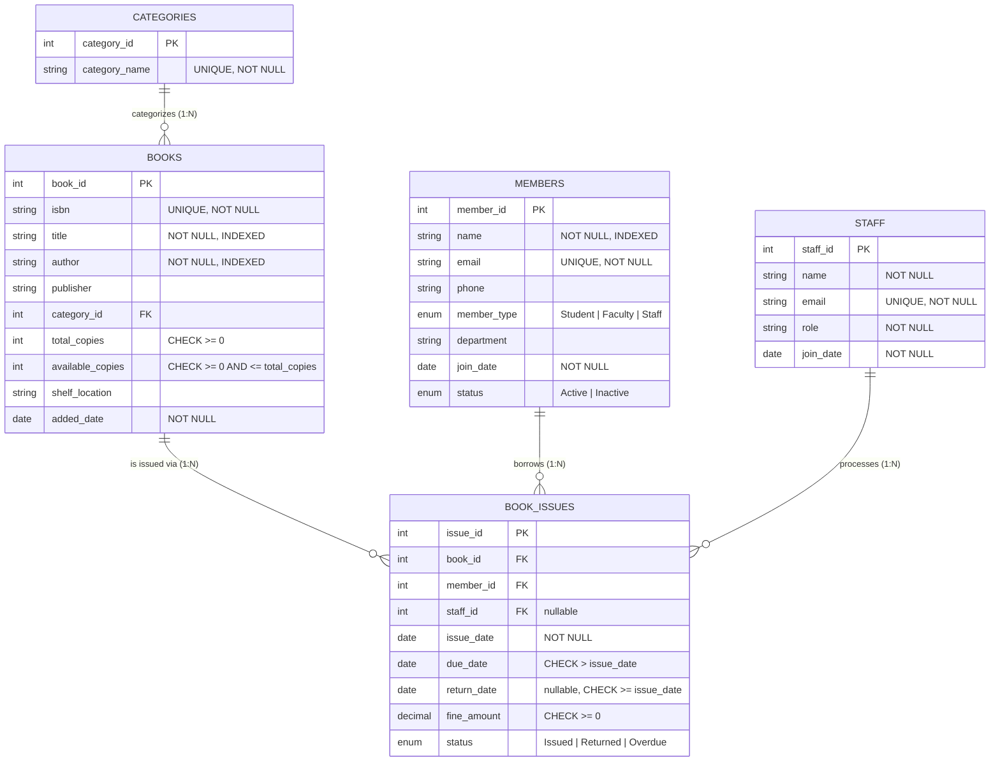

# Entity-Relationship Diagram

The diagram below is written in [Mermaid](https://mermaid.js.org/) syntax. GitHub, GitLab, and most modern
Markdown viewers (including VS Code with the Mermaid extension) render this automatically. You can also
paste the code block into the [Mermaid Live Editor](https://mermaid.live) to export a PNG/SVG image.

## Cardinality summary

| Relationship | Type | Notes |
|---|---|---|
| Category → Books | 1 : N | One category groups many books. A book belongs to exactly one category. |
| Book → BookIssues | 1 : N | One book can be issued many times over its lifetime (across different transactions), but only while `available_copies > 0`. |
| Member → BookIssues | 1 : N | One member can have many issue/borrow transactions. |
| Staff → BookIssues | 1 : N | One staff member can process many transactions. `staff_id` is nullable (transaction may be unattributed / staff record later removed). |

Books and Members have an **indirect N:N relationship** realized through the `BOOK_ISSUES` associative/junction
table (a member can borrow many books over time, and a book can be borrowed by many members over time — just
not concurrently, enforced by the `available_copies` counter).

## ON DELETE strategy rationale

| FK | ON DELETE | Reason |
|---|---|---|
| `books.category_id → categories.category_id` | `RESTRICT` | Prevents deleting a category that still has books referencing it, avoiding orphaned/NULL categories. Admin must reassign books first. |
| `book_issues.book_id → books.book_id` | `RESTRICT` | A book with transaction history (even old, returned ones) must not be deleted — required for audit trail and fine history. |
| `book_issues.member_id → members.member_id` | `RESTRICT` | Preserves borrowing history for a member even if they are otherwise deactivated (`status = Inactive`) rather than hard-deleted. |
| `book_issues.staff_id → staff.staff_id` | `SET NULL` | If a librarian leaves and their staff record is removed, historical transactions they processed remain (with `staff_id = NULL`) rather than being blocked or deleted. |
