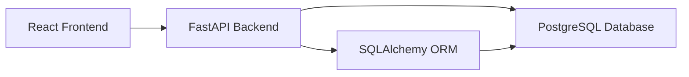

# Project Documentation

## 1. Project Overview

This project is a full-stack Library Management System designed for managing a college or institutional library. It supports catalog management for books, member registration, staff tracking, and book issue/return transactions.

The application is built using:

- Frontend: React + Vite
- Backend: FastAPI (Python)
- Database: PostgreSQL
- ORM and migrations: SQLAlchemy + Alembic

The system is designed to support daily library operations such as issuing books, monitoring overdue items, calculating fines, and maintaining a searchable catalogue.

---

## 2. Objectives

The main objectives of the system are:

- Maintain a digital record of all available books and their categories
- Manage library members and staff information
- Record book issuance and return activity
- Detect overdue books and calculate penalties
- Provide a clean, responsive user interface for librarians
- Enforce data integrity through database constraints and API validation

---

## 3. Scope

### In scope

- Book inventory management
- Category-based classification
- Member registration and status tracking
- Staff management
- Issue/return transaction processing
- Search, sorting, filtering, and pagination
- Overdue and fine calculation logic
- REST API exposure for front-end integration

### Out of scope

- User authentication and authorization
- Email/SMS notifications
- Payment gateway integration
- Multi-library branch support
- Advanced reporting dashboards beyond the application UI

---

## 4. System Architecture

The application follows a three-tier architecture:



### Frontend layer

The frontend is developed with React and Vite. It provides pages for:

- Books
- Members
- Staff
- Issues
- Create/edit forms for each module

It communicates with the backend through Axios request helpers and a shared API client.

### Backend layer

The backend is a FastAPI application that exposes REST endpoints for all library resources. It handles:

- Request validation using Pydantic
- Business rules for issue/return operations
- Error handling and HTTP status codes
- Interaction with the database using SQLAlchemy

### Database layer

The database is PostgreSQL. The schema includes tables for:

- categories
- books
- members
- staff
- book_issues

Database integrity is maintained through foreign keys, check constraints, and enums.

---

## 5. Functional Modules

### 5.1 Book Management

The book module allows users to:

- Add new books
- Update book details
- Delete books when allowed
- Search by title, author, or ISBN
- Filter by category
- View availability and copy counts

Key fields include:

- ISBN
- Title
- Author
- Publisher
- Category
- Total copies
- Available copies
- Shelf location
- Added date

### 5.2 Member Management

The member module manages library members details and status.

Features include:

- Registration of students, faculty, and staff members
- Search by name or email
- Filter by type and status
- Status tracking: Active / Inactive

### 5.3 Staff Management

The staff module tracks librarians or library staff responsible for transaction handling.

Fields include:

- Name
- Email
- Role
- Join date

### 5.4 Issue and Return Workflow

This is the core operational module.

A transaction stores:

- book
- member
- issuing staff
- issue date
- due date
- return date
- status
- fine amount

Business logic includes:

- Issue operation reduces available copies
- Return operation increases available copies
- Overdue status is calculated based on due date
- Fine is computed at ₹5 per day when applicable
- Deleting records tied to transaction history is restricted

---

## 6. Data Model Summary

### Categories

Stores reusable book categories such as Computer Science, Fiction, History, and others.

### Books

Stores the catalog record for each title with stock information and category linkage.

### Members

Stores borrowers and their account information, including department and status.

### Staff

Stores librarians and staff roles involved in issuing and returning books.

### Book Issues

Stores the borrowing transaction log. It is the central table connecting books, members, and staff.

---

## 7. Business Rules

The application enforces important business rules at the API and database levels:

- Book issue requires available copies
- Issue is rejected if no copies are available
- Return updates stock and fine calculations
- Due date must be later than issue date
- A book with prior transaction history cannot be deleted without careful handling
- Category deletion is restricted when related books exist
- Member status helps regulate active borrowing eligibility

---

## 8. API Design

The backend exposes RESTful endpoints grouped by resource.

### Core endpoints

- Categories
- Books
- Members
- Staff
- Issues

### Common patterns

- GET for listing and retrieval
- POST for create
- PUT for update
- DELETE for removal
- Query parameters for search, filter, sort, and pagination

### Response behavior

- 200 OK for successful reads and updates
- 201 Created for new records
- 204 No Content for deletions
- 400 Bad Request for validation failures
- 404 Not Found for missing resources
- 409 Conflict for business-rule violations

---

## 9. User Interface

The frontend uses a responsive layout and supports:

- Table-based listing for records
- Search boxes and filters
- Sortable columns
- Pagination
- Empty states and loading placeholders
- Confirmation modals for delete actions
- Status badges for item state visualization

The UI is intended for quick operational use by library staff rather than a general public portal.

---

## 10. Project Structure

```text
DBMS PROJECT/
├── backend/
│   ├── app/
│   │   ├── core/
│   │   ├── models/
│   │   ├── routers/
│   │   ├── schemas/
│   │   ├── database.py
│   │   └── main.py
│   ├── alembic/
│   ├── scripts/
│   ├── requirements.txt
│   └── alembic.ini
├── frontend/
│   ├── src/
│   ├── package.json
│   └── vite.config.js
├── ER_DIAGRAM.md
├── DATA_DICTIONARY.md
├── PROJECT_DOCUMENTATION.md
├── README.md
└── .gitignore
```

---

## 11. Complete API and Database Documentation

The project implements the following modules in real code:

### Categories module

- Endpoint group: /api/categories
- Actions: list, fetch, create, update, delete
- Validation: category name must be unique and non-empty
- Database relationship: one-to-many with books

### Books module

- Endpoint group: /api/books
- Actions: list with search/filter/sort/pagination, fetch, create, update, delete
- Validation: ISBN regex, copy count checks, category existence
- Database relationship: many books belong to one category

### Members module

- Endpoint group: /api/members
- Actions: list with search/filter/sort/pagination, fetch, create, update, delete
- Validation: email uniqueness and status rules
- Database relationship: one member may have many issue records

### Staff module

- Endpoint group: /api/staff
- Actions: list, fetch, create, update, delete
- Validation: unique email and role details
- Database relationship: one staff record may process many transactions

### Issues module

- Endpoint group: /api/issues
- Actions: list, fetch, create, update, delete
- Validation: valid book/member/staff references, stock availability, member activity, date ordering
- Database relationship: many issue records belong to one book, one member, and optionally one staff member

### Database behavior

The database is designed to be normalized and integrity-safe:

- categories are separate from books to avoid repeated data
- books are linked to categories through category_id
- issue history is preserved in a dedicated transaction table
- stock is tracked using available_copies and total_copies
- all critical relationships use foreign keys and constraints

---

## 12. Conclusion

This project demonstrates a complete library management workflow from catalogue creation to borrowing and returns. The documentation above matches the implementation and explains the API design, frontend flow, database model, and library business rules in a practical and operational way.

DBMS Project/
├── backend/
│   ├── alembic/
│   ├── app/
│   ├── scripts/
│   ├── alembic.ini
│   ├── requirements.txt
│   └── .env.example
├── frontend/
│   ├── src/
│   ├── public/
│   ├── index.html
│   ├── package.json
│   └── .env.example
├── DATA_DICTIONARY.md
├── ER_DIAGRAM.md
├── PROJECT_DOCUMENTATION.md
├── README.md
└── .gitignore
```

---

## 11. Setup and Configuration

### Prerequisites

- Python 3.11+
- Node.js 18+
- PostgreSQL 14+
- npm and pip

### Backend setup

1. Create a virtual environment
2. Install dependencies from requirements.txt
3. Configure environment variables in a .env file
4. Create the PostgreSQL database
5. Run Alembic migrations
6. Seed demo data

### Frontend setup

1. Install npm dependencies
2. Configure frontend environment variables
3. Start Vite development server

### Default development URLs

- Frontend: http://localhost:5173
- Backend: http://localhost:8000
- Swagger docs: http://localhost:8000/docs

---

## 12. Database Integrity and Constraints

The database uses several design safeguards:

- Foreign key constraints to maintain valid relationships
- Unique constraints for ISBN and email
- Enum constraints for controlled values
- Check constraints for quantity and fine validation
- Restrictive deletes to preserve historical records

These rules help ensure the system remains reliable and prevents corrupted data.

---

## 13. Security and Operational Notes

This project currently focuses on operational functionality rather than enterprise-grade security. Important notes:

- There is no user authentication layer in the current version
- The project is intended for local deployment or internal library use
- CORS is configured for development access
- Environment variables should be kept private and not committed to public repositories

---

## 14. Testing and Validation

The project includes a database seed script and manual validation workflows. Standard verification involves:

- Starting the backend
- Starting the frontend
- Creating books, members, and staff records
- Issuing books to members
- Returning books and checking fines
- Reviewing overdue logic

---

## 15. Future Enhancements

Possible future improvements include:

- Authentication and role-based access control
- User login for librarians and admins
- Email reminders for due books
- Advanced analytics and reporting
- Barcode or QR-based book tracking
- Reservation and renewal features
- Export to PDF or CSV

---

## 16. Conclusion

This Library Management System provides a practical and well-structured solution for managing a library’s core operations. It combines modern frontend development with a robust backend and a normalized relational database, making it suitable for educational and demonstration use while also serving as a solid base for future extension.

For schema-level details, refer to:

- [DATA_DICTIONARY.md](DATA_DICTIONARY.md)
- [ER_DIAGRAM.md](ER_DIAGRAM.md)
- [README.md](README.md)
