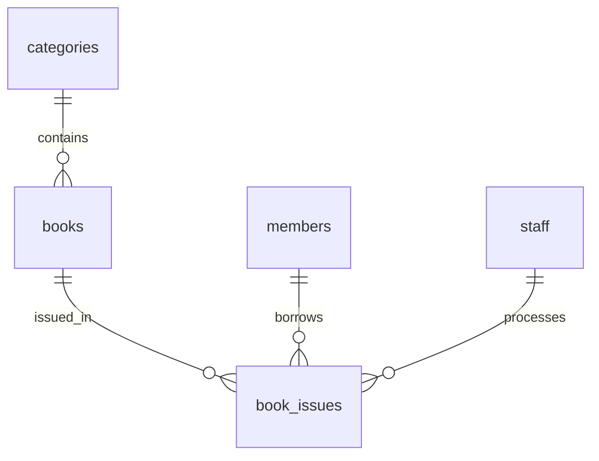

# Library Management System Documentation

This project is a full-stack library management system for managing book inventory, member records, staff records, and issue-return transactions in a college or institutional library. The system combines a React frontend, a FastAPI backend, and a PostgreSQL database.

It is designed to model the real operational workflow of a library desk: cataloguing books, registering borrowers, assigning staff to transactions, issuing books, tracking due dates, managing returns, and calculating overdue fines.

---

## 1. Project Overview

### Objective

The application exists to replace manual library administration tasks with a structured digital system that keeps records consistent and easy to query.

The core goals are:

- manage the library catalogue efficiently
- keep a reliable borrower record database
- track staff involved in issue/return processing
- maintain book loan history for accountability
- automatically identify overdue books and calculate fines
- provide a simple user interface for librarians
- enforce data integrity through validation and database constraints

### Business Domain

The project covers the common operational areas of a library:

- catalog management
- category management
- member administration
- staff administration
- book issue and return lifecycle
- overdue monitoring
- fine calculation
- audit-friendly transactional history

### Core User Roles

- Librarian or staff member: manages books, members, and loan transactions
- Borrower/member: receives issued books and is tracked in the system
- Administrator: maintains catalogue and reference data such as categories

---

## 2. System Architecture

The application follows a three-layer design:


### Frontend Layer

Built with React and Vite, the frontend provides:

- page-based navigation
- search and filter controls
- table listing views
- create/edit forms
- delete confirmations
- status badges and visual feedback
- responsive layout for desktop and smaller screens

### Backend Layer

Built with FastAPI, the backend provides:

- REST API routes
- Pydantic validation
- database session handling via SQLAlchemy
- business rules and conflict handling
- CORS configuration for frontend access
- JSON error responses for client-side feedback

### Database Layer

The database is PostgreSQL and stores the business data in normalized tables:

- categories
- books
- members
- staff
- book_issues

This design keeps repeated data normalized while preserving transaction-level history for auditing and reporting.

---

## 3. Technology Stack

| Layer | Technology |
|---|---|
| Frontend | React, Vite, React Router, Axios |
| Styling | Tailwind CSS |
| Backend | Python, FastAPI |
| Validation | Pydantic v2 |
| ORM | SQLAlchemy 2.0 |
| Database | PostgreSQL |
| Migrations | Alembic |
| Data seeding | Python script |

### Why this stack was chosen

- FastAPI gives fast API development, built-in validation, and clean route definitions
- SQLAlchemy provides strong ORM mapping to PostgreSQL tables
- React provides a dynamic, responsive interface for data handling and forms
- PostgreSQL provides relational integrity, constraints, and reliable transaction support
- Alembic preserves schema evolution across project changes

---

## 4. Project Structure

```text
DBMS PROJECT/
├── README.md
├── PROJECT_DOCUMENTATION.md
├── ER_DIAGRAM.md
├── DATA_DICTIONARY.md
├── backend/
│   ├── alembic/
│   │   ├── versions/
│   │   ├── env.py
│   │   ├── README
│   │   └── script.py.mako
│   ├── app/
│   │   ├── core/
│   │   │   └── config.py
│   │   ├── models/
│   │   │   ├── book.py
│   │   │   ├── category.py
│   │   │   ├── issue.py
│   │   │   ├── member.py
│   │   │   └── staff.py
│   │   ├── routers/
│   │   │   ├── books.py
│   │   │   ├── categories.py
│   │   │   ├── issues.py
│   │   │   ├── members.py
│   │   │   └── staff.py
│   │   ├── schemas/
│   │   │   ├── book.py
│   │   │   ├── category.py
│   │   │   ├── common.py
│   │   │   ├── issue.py
│   │   │   ├── member.py
│   │   │   └── staff.py
│   │   ├── database.py
│   │   └── main.py
│   ├── scripts/
│   │   └── seed.py
│   ├── requirements.txt
│   ├── alembic.ini
│   └── .env.example
├── frontend/
│   ├── public/
│   ├── src/
│   │   ├── api/
│   │   │   ├── books.js
│   │   │   ├── categories.js
│   │   │   ├── client.js
│   │   │   ├── issues.js
│   │   │   ├── members.js
│   │   │   └── staff.js
│   │   ├── components/
│   │   ├── hooks/
│   │   ├── layouts/
│   │   ├── pages/
│   │   ├── utils/
│   │   ├── App.jsx
│   │   ├── main.jsx
│   │   └── index.css
│   ├── index.html
│   ├── package.json
│   ├── postcss.config.js
│   └── vite.config.js
└── .gitignore
```

---

## 5. Module-by-Module Explanation

### 5.1 Category Module

The category module organizes the library catalogue into logical subject groups such as Computer Science, Fiction, History, or General Knowledge.

Responsibilities:

- create new categories
- update category names
- list all categories
- fetch a single category
- prevent deletion when books still refer to it

API route group:

- /api/categories

Key table:

- categories

Important behavior:

- category names are unique
- category deletion is restricted if books exist for that category

### 5.2 Book Module

The book module is the core inventory area. It manages the actual library catalogue.

Responsibilities:

- add a new book title
- validate ISBN format
- set total and available copies
- assign books to a category
- search by title, author, or ISBN
- filter by category
- sort by title, author, ISBN, date, or stock
- paginate large lists
- delete only when no issue history exists

API route group:

- /api/books

Key table:

- books

Important business logic:

- ISBN must be valid 10- or 13-digit format
- available_copies cannot exceed total_copies
- every book belongs to a category
- creating or updating a book with an existing ISBN is blocked

### 5.3 Member Module

The member module stores all library borrowers.

Responsibilities:

- register a new member
- classify as Student, Faculty, or Staff
- manage department and join date
- track member status: Active or Inactive
- search by name or email
- sort by field
- allow soft lifecycle tracking without data loss

API route group:

- /api/members

Key table:

- members

Important behavior:

- email is unique
- inactive members cannot issue new books
- member deletion is restricted if they have loan history

### 5.4 Staff Module

The staff module stores librarians and library administrators responsible for handling transactions.

Responsibilities:

- add staff records
- list staff members
- update their details
- remove staff only when allowed

API route group:

- /api/staff

Key table:

- staff

Important behavior:

- email is unique
- staff records can be deleted without deleting transaction history because book_issues.staff_id uses SET NULL

### 5.5 Issue/Return Module

This is the critical operational module. The issue module controls all lending and returning workflows.

Responsibilities:

- issue a book to a member
- set issue date and due date
- set or update return date
- track status: Issued, Returned, Overdue
- calculate fine when late
- replenish or reduce stock depending on the workflow
- automatically detect overdue states

API route group:

- /api/issues

Key table:

- book_issues

Important business rules:

- issue is rejected when available_copies is zero
- member must be Active to issue a book
- due_date must be after issue_date
- return_date cannot be before issue_date
- if a book is returned late, fine is computed at ₹5 per day
- overdue state is recalculated automatically on read when a due date has passed and the book is not returned

---

## 6. Frontend Module Breakdown

### Routing and navigation

The React application is configured in App.jsx and handles the main routes:

- /books
- /books/new
- /books/:id/edit
- /members
- /members/new
- /members/:id/edit
- /staff
- /staff/new
- /staff/:id/edit
- /issues
- /issues/new
- /issues/:id/edit

### Frontend API layer

The shared client is defined in frontend/src/api/client.js.

It provides:

- a common Axios base URL
- JSON content headers
- global error formatting
- conversion of backend validation errors into readable messages

The per-resource API modules include:

- books.js
- categories.js
- members.js
- staff.js
- issues.js

These modules wrap the backend endpoints with clean frontend functions for list, create, update, fetch, and delete operations.

### UI pages

The application includes grid pages and form pages for each resource:

- BooksGridPage.jsx and BookFormPage.jsx
- MembersGridPage.jsx and MemberFormPage.jsx
- StaffGridPage.jsx and StaffFormPage.jsx
- IssuesGridPage.jsx and IssueFormPage.jsx

### Reusable components

The frontend contains generic building blocks for data-heavy pages:

- Pagination.jsx
- SortableHeader.jsx
- StatusBadge.jsx
- ConfirmModal.jsx
- EmptyState.jsx
- TableSkeleton.jsx

This reduces duplication and keeps the list pages consistent.

---

## 7. Backend API Design

The FastAPI app is configured in backend/app/main.py.

### Application setup

The app exposes:

- title: Library Management System API
- version: 1.0.0
- CORS middleware for frontend origin access
- validation error handling via RequestValidationError
- health check route at /api/health

### Router structure

Each resource has its own router file:

- categories.py
- books.py
- members.py
- staff.py
- issues.py

This keeps the API modular and easier to maintain.

### Shared API conventions

All routes are grouped under /api.

HTTP conventions used in the project:

- GET: fetch records
- POST: create records
- PUT: update records
- DELETE: remove records
- 200 OK: successful response
- 201 Created: record created successfully
- 204 No Content: deletion successful
- 400 Bad Request: validation or database-level invalid input
- 404 Not Found: missing record
- 409 Conflict: duplicate entry or forbidden state change

---

## 8. API Reference

### 8.1 Category API

Base path: /api/categories

| Method | Route | Purpose |
|---|---|---|
| GET | /api/categories | List all categories |
| GET | /api/categories/{category_id} | Fetch one category |
| POST | /api/categories | Create a category |
| PUT | /api/categories/{category_id} | Update a category |
| DELETE | /api/categories/{category_id} | Delete a category |

Request example:

```json
{
  "category_name": "Computer Science"
}
```

### 8.2 Book API

Base path: /api/books

| Method | Route | Purpose |
|---|---|---|
| GET | /api/books | List paginated and filtered books |
| GET | /api/books/{book_id} | Fetch one book |
| POST | /api/books | Create a book |
| PUT | /api/books/{book_id} | Update a book |
| DELETE | /api/books/{book_id} | Delete a book |

Query parameters for listing:

- search
- category_id
- sort_by
- sort_dir
- page
- page_size

Example create payload:

```json
{
  "isbn": "9780132350884",
  "title": "Clean Code",
  "author": "Robert C. Martin",
  "publisher": "Prentice Hall",
  "category_id": 1,
  "total_copies": 5,
  "available_copies": 5,
  "shelf_location": "A-1",
  "added_date": "2026-09-30"
}
```

### 8.3 Member API

Base path: /api/members

| Method | Route | Purpose |
|---|---|---|
| GET | /api/members | List members with filters and pagination |
| GET | /api/members/{member_id} | Fetch one member |
| POST | /api/members | Create a member |
| PUT | /api/members/{member_id} | Update a member |
| DELETE | /api/members/{member_id} | Delete a member |

Example payload:

```json
{
  "name": "Aisha Khan",
  "email": "aisha.khan@example.com",
  "phone": "9876543210",
  "member_type": "Student",
  "department": "Computer Science",
  "join_date": "2026-09-01",
  "status": "Active"
}
```

### 8.4 Staff API

Base path: /api/staff

| Method | Route | Purpose |
|---|---|---|
| GET | /api/staff | List staff |
| GET | /api/staff/{staff_id} | Fetch one staff record |
| POST | /api/staff | Create a staff record |
| PUT | /api/staff/{staff_id} | Update a staff record |
| DELETE | /api/staff/{staff_id} | Delete a staff record |

Example payload:

```json
{
  "name": "Ritika Sharma",
  "email": "ritika.sharma@library.edu",
  "role": "Assistant Librarian",
  "join_date": "2025-01-10"
}
```

### 8.5 Issue API

Base path: /api/issues

| Method | Route | Purpose |
|---|---|---|
| GET | /api/issues | List issue records with filters |
| GET | /api/issues/{issue_id} | Fetch one issue record |
| POST | /api/issues | Issue a book to a member |
| PUT | /api/issues/{issue_id} | Update an issue record |
| DELETE | /api/issues/{issue_id} | Delete an issue record |

Example payload:

```json
{
  "book_id": 2,
  "member_id": 4,
  "staff_id": 1,
  "issue_date": "2026-09-20",
  "due_date": "2026-09-30",
  "return_date": null,
  "fine_amount": 0,
  "status": "Issued"
}
```

### Issue update scenario

When an issue is updated to Returned, the API does the following:

- checks whether the book is being returned for the first time
- computes late fine = ($days_late \times 5$) if overdue
- sets return_date if not already provided
- increments available_copies up to total_copies
- marks status as Returned

When a returned issue is reverted to Issued:

- stock is reduced again
- the record is treated as active borrowing once more

---

## 9. Database Design and Schema

### 9.1 Table: categories

| Column | Type | Description |
|---|---|---|
| category_id | Integer, PK | Unique category id |
| category_name | String(100) | Unique category name |

### 9.2 Table: books

| Column | Type | Description |
|---|---|---|
| book_id | Integer, PK | Unique book id |
| isbn | String(20) | Unique ISBN |
| title | String(255) | Book title |
| author | String(255) | Author |
| publisher | String(255) | Publisher |
| category_id | Integer, FK | Category reference |
| total_copies | Integer | Total available copies in library |
| available_copies | Integer | Copies currently available on shelf |
| shelf_location | String(50) | Physical shelf code |
| added_date | Date | Date added to catalogue |

Constraints:

- total_copies >= 0
- available_copies >= 0
- available_copies <= total_copies

### 9.3 Table: members

| Column | Type | Description |
|---|---|---|
| member_id | Integer, PK | Unique member id |
| name | String(255) | Member name |
| email | String(255) | Unique email |
| phone | String(20) | Contact number |
| member_type | Enum | Student, Faculty, or Staff |
| department | String(100) | Department or unit |
| join_date | Date | Registration date |
| status | Enum | Active or Inactive |

### 9.4 Table: staff

| Column | Type | Description |
|---|---|---|
| staff_id | Integer, PK | Unique staff id |
| name | String(255) | Staff name |
| email | String(255) | Unique email |
| role | String(100) | Job or role |
| join_date | Date | Joining date |

### 9.5 Table: book_issues

| Column | Type | Description |
|---|---|---|
| issue_id | Integer, PK | Unique issue transaction id |
| book_id | Integer, FK | Book being issued |
| member_id | Integer, FK | Borrower identity |
| staff_id | Integer, FK | Transaction handling staff |
| issue_date | Date | Issue date |
| due_date | Date | Due date |
| return_date | Date | Return date if returned |
| fine_amount | Numeric(10,2) | Amount due |
| status | Enum | Issued, Returned, Overdue |

Constraints:

- due_date > issue_date
- fine_amount >= 0
- return_date >= issue_date when not null

### Relationship summary



### Referential integrity rules

| Foreign key | Rule |
|---|---|
| books.category_id -> categories.category_id | RESTRICT on delete |
| book_issues.book_id -> books.book_id | RESTRICT on delete |
| book_issues.member_id -> members.member_id | RESTRICT on delete |
| book_issues.staff_id -> staff.staff_id | SET NULL on delete |

These rules protect historical records and avoid accidental loss of business data.

---

## 10. Business Rules and Validation Logic

The project enforces business logic both in the API and in the database.

### Book stock rules

- available_copies decreases on issue
- available_copies increases on return
- available_copies cannot exceed total_copies
- book issue fails if no physical copies are available

### Member rules

- an inactive member cannot borrow books
- a member must exist before borrowing
- duplicate email is rejected

### Transaction rules

- issue_date and due_date must be valid
- due_date must be after issue_date
- return_date cannot be before issue_date
- return is tracked with status changes and calculated fine
- overdue state is determined as a function of date comparison

### Fine logic

Late fine is calculated as:

$$
\text{fine} = \max(0, \text{days late}) \times 5
$$

The project uses ₹5 per day overdue for returned books when they are late.

---

## 11. Setup and Running Instructions

### Prerequisites

- Python 3.11+
- Node.js 18+
- PostgreSQL 14+
- npm

### Backend setup

```bash
cd backend
python -m venv venv
source venv/Scripts/activate
pip install -r requirements.txt
```

Create the database:

```sql
CREATE DATABASE library_db;
```

Update environment values if necessary, then run:

```bash
alembic upgrade head
python -m scripts.seed
uvicorn app.main:app --reload --port 8000
```

### Frontend setup

```bash
cd frontend
npm install
npm run dev -- --port 5173
```

### Access points

- Backend API: http://localhost:8000/api
- Swagger docs: http://localhost:8000/docs
- Frontend app: http://localhost:5173

---

## 12. Typical Workflow

A typical library workflow in this application is:

1. create categories
2. add books under categories
3. register members
4. add staff accounts
5. issue a book to a member
6. record due date and staff assignment
7. return the book on or before due date
8. mark the transaction as returned and calculate fine if late
9. keep records for audit and analysis

---

## 13. Summary

This project is a practical library management system that models real-world book circulation operations using a modern web stack. It covers the complete data lifecycle from catalogue creation to borrow-return tracking and overdue monitoring.

It demonstrates:

- a clear relational database model
- modular REST API design
- robust validation and business logic
- full-stack application flow from UI to database
- proper handling of stock, member activity, and transaction history

This documentation is intended to serve as a complete reference for understanding the system implementation, database structure, and API operations.

For the database diagram and column-level reference, see [ER_DIAGRAM.md](ER_DIAGRAM.md) and [DATA_DICTIONARY.md](DATA_DICTIONARY.md).
